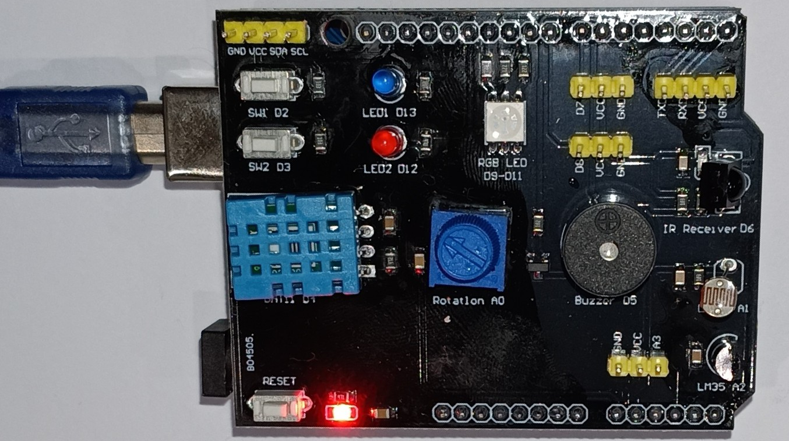
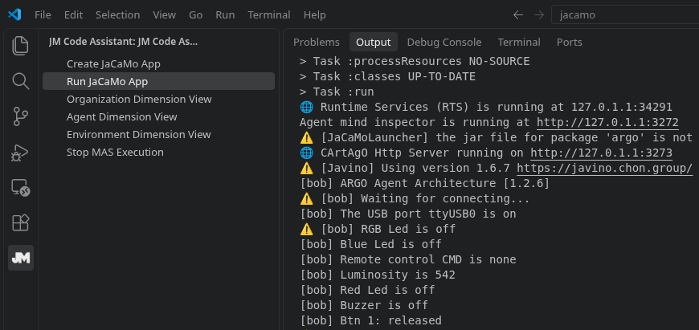
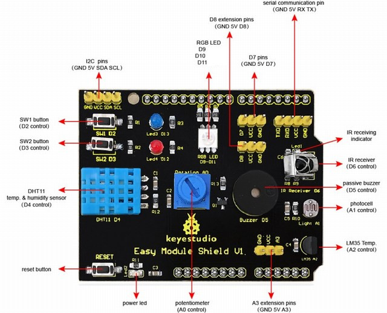

# Multi-purpose Shield V1 Learning Module + Uno R3



This prototype demonstrates the integration of a BDI cognitive agent with an Arduino Uno R3 equipped with a Multi-purpose Shield V1. Using the ARGO architecture, the agent controls LEDs and a buzzer through a predefined sequence of actions while receiving perceptions from the shield's sensors, buttons, infrared receiver, and actuators.

**Execution:** Physical  
**BDI Agent Architecture:** [ARGO](https://jasonembedded.chon.group)  
**Environment:** [Arduino Uno R3](https://www.usinainfo.com.br/placas-arduino-compativel/placa-uno-smd-compativel-arduino-cabo-usb-4485.html) + [Multi-purpose Shield V1](https://www.usinainfo.com.br/shieldsexpansores/shield-multifuncoes-hy-m302-para-arduino-com-dht11-lm35-receptor-ir-ldr-leds-buzzer-e-outros-4866.html)  
**Difficulty:** Introductory

## Overview

The Multi-purpose Shield V1 is an educational expansion board designed for Arduino microcontrollers. It integrates several sensors and actuators into a single platform, allowing experiments without additional wiring or soldering.

The shield includes temperature and humidity sensors (DHT11), a temperature sensor (LM35), a light-dependent resistor (LDR), two push buttons, two LEDs, an RGB LED, a buzzer, an infrared receiver, and a potentiometer.


## Architecture

This prototype follows the folow architecture. 

### L4 — Reasoning Layer

The agent establishes a serial connection with the Arduino Uno R3 and executes the `helloWorld` goal once the connection is available. This goal triggers a predefined sequence of actions: turning the red and blue LEDs on and off, activating and deactivating the buzzer, and changing the RGB LED through white, green, blue, and red before turning it off. A one-second interval separates consecutive commands.

The agent also defines plans triggered by belief-addition events (`+b`) associated with perceptions received from the shield, including sensor readings, button states, infrared remote-control commands, and actuator states. These plans print the corresponding belief values to the console.

If the `helloWorld` goal cannot be executed because no applicable plan is available, the agent waits for a randomized interval before retrying.

- **Agent(s):** `bob`
- **Frameworks:** Jason, JaCaMo, JasonEmbedded, and ChonIDE.
- **Source code:**
  - [Jason](reasoning/jason/)
  - [JaCaMo](reasoning/jacamo/)
  - [JasonEmbedded](reasoning/jasonEmbedded/)
  - [ChonIDE](reasoning/chonIDE/multiPurposeShield.chon)




### L3 — Interfacing Layer

The interfacing layer provides bidirectional serial communication between the BDI agent and the Arduino Uno R3 through the Javino protocol. Agents send commands to control the shield's actuators and receive perceptions representing sensor readings, button states, infrared commands, and actuator states.

- **Middleware/protocol:** Javino (serial communication at 9600 baud).

#### Actions

```asl
.act(ledRedOn | ledRedOff);                            // Red LED
.act(ledBlueOn | ledBlueOff);                          // Blue LED
.act(buzzerOn | buzzerOff);                            // Buzzer
.act(rgbWhite | rgbGreen | rgbBlue | rgbRed | rgbOff); // RGB LED
```

#### Percepts

```asl
+port(Port,Status).                     // Serial connection status

+button1(pressed | released).           // Button 1
+button2(pressed | released).           // Button 2

+temp(T).                               // Temperature (°C)
+hum(H).                                // Relative humidity (%)
+lum(L).                                // Luminosity (analog reading)
+pot(P).                                // Potentiometer (analog reading)

+cmd(C).                                // IR command or none

+red(on | off).                         // Red LED state
+blue(on | off).                        // Blue LED state
+buzzer(on | off).                      // Buzzer state
+rgb(red | green | blue | white | off). // RGB LED state

+dht(error).                            // DHT11 reading unavailable
```


### L2 — Controlling Layer

The controlling layer is implemented on an Arduino Uno R3 running firmware developed in Arduino C++. The firmware manages the Multi-purpose Shield V1 sensors and actuators, processes commands received from the BDI agent, and prepares environmental perceptions for transmission through Javino.

The firmware handles digital and analog inputs, infrared remote-control commands, button events, temperature and humidity measurements, and the operation of LEDs and the buzzer.

- **Controller:** Arduino Uno R3 (ATmega328P).
- **Firmware/source:** [arduino.ino](controlling/arduino/arduino.ino)
- **Communication:** Javino over serial communication at 9600 baud.
- **Build/deployment:** Compile and upload `arduino.ino` to the Arduino Uno R3 using the Arduino IDE or Arduino CLI.

**Required Arduino libraries:**
- [Javino](https://github.com/chon-group/javino2arduino)
- [DHT Sensor Library](https://github.com/adafruit/DHT-sensor-library)
- [Adafruit Unified Sensor](https://github.com/adafruit/Adafruit_Sensor)
- [Arduino-IRremote](https://github.com/Arduino-IRremote/Arduino-IRremote)

### L1 — Actuating Layer

The actuating layer consists of a Multi-purpose Shield V1 mounted on an Arduino Uno R3. The shield integrates sensors and actuators into a single board, allowing the cognitive agent to interact with the physical environment without additional wiring.

**Physical implementation:**

- **Controller board:** Arduino Uno R3.
- **Expansion board:** Multi-purpose Shield V1.
- **Assembly:** Attach the shield directly to the Arduino Uno R3.

#### Hardware Pinout



| Arduino Pin | Component | Description |
|---|---|---|
| D0–D1 | TTL Serial | TX/RX serial communication |
| D2 | SW1 | Push button 1 |
| D3 | SW2 | Push button 2 |
| D4 | DHT11 | Temperature and humidity sensor |
| D5 | Buzzer | Passive buzzer |
| D6 | IR Receiver | Infrared remote-control receiver |
| D7–D8 | Digital Expansion | 3-pin connectors |
| D9 | RGB LED | Red channel |
| D10 | RGB LED | Blue channel |
| D11 | RGB LED | Green channel |
| D12 | Red LED | Red indicator LED |
| D13 | Blue LED | Blue indicator LED |
| A0 | Potentiometer | Analog input |
| A1 | LDR | Light intensity sensor |
| A2 | LM35 | Analog temperature sensor |
| A3 | Analog Expansion | 3-pin connector |
| A4–A5 | I²C | SDA/SCL interface |

**Additional documentation:**

- [Complete circuit schematic](actuating/physical/Schematic_Multi-purpose-Shield-V1-big.jpg)
- [Multi-purpose Shield V1 — ADRIROBOT](https://www.adrirobot.it/multi-purpose-shield-v1/)

*Pinout and circuit schematic source: ADRIROBOT.*


#### Hardware Requirements

To reproduce this experiment, you need an **Arduino Uno R3** and a **Multi-purpose Shield V1**. The shield connects directly to the Arduino, so no additional wiring or soldering is required.

| Component | Quantity | Where to buy |
|---|---|---|
| Arduino Uno + USB Cable | 1 | [UsinaInfo](https://www.usinainfo.com.br/placas-arduino-compativel/placa-uno-smd-compativel-arduino-cabo-usb-4485.html) |
| Multi-purpose Shield V1 | 1 | [UsinaInfo](https://www.usinainfo.com.br/shieldsexpansores/shield-multifuncoes-hy-m302-para-arduino-com-dht11-lm35-receptor-ir-ldr-leds-buzzer-e-outros-4866.html) |


#### Simulated Implementation

- Not available for this prototype.


## Requirements

To reproduce this prototype, the following hardware and software are required:

**Hardware:**
- Arduino Uno R3 (or compatible board).
- Multi-purpose Shield V1.
- USB cable for connecting the Arduino to the computer.

See [Hardware Requirements](#hardware-requirements) for purchasing links and compatibility information.

**Software:**
- Arduino IDE or Arduino CLI.
- Jason, JaCaMo, or JasonEmbedded, depending on the selected reasoning implementation.
- Javino library for Arduino.
- DHT Sensor Library and its required dependencies.
- Arduino-IRremote library.
- A computer with an available USB serial port.

The provided agent configuration uses `/dev/ttyUSB0` on Linux. Adjust the serial port according to your operating system and device configuration.

## How to Run

1. Connect the Multi-purpose Shield V1 to the Arduino Uno R3.
2. Connect the Arduino to your computer using a USB cable.
3. Open [arduino.ino](controlling/arduino/arduino.ino) in the Arduino IDE and install the required libraries.
4. Select the Arduino Uno board and the corresponding serial port, then compile and upload the firmware.
5. Choose one of the available implementations in the [Reasoning Layer](#l4--reasoning-layer).
6. Configure the serial port in the agent's `serialPort` belief. On Linux, the default example is `ttyUSB0`.
7. Start the selected agent project.

**Expected behavior:**

After establishing the serial connection, the agent `bob` executes the `helloWorld` goal. The red and blue LEDs turn on and off, the buzzer is activated and deactivated, and the RGB LED cycles through white, green, blue, and red before turning off.

A one-second interval separates consecutive actions.

The agent also receives perceptions from the shield, including sensor readings, button states, infrared remote-control commands, and actuator states. These perceptions are displayed in the agent's console as belief-addition events occur.

## Authors and References

N. Lazarin, C. Pantoja, and J. Viterbo. " Towards a Toolkit for Teaching AI Supported by Robotic-agents: Proposal and First Impressions", in Proceedings of the 31st Workshop on Computing Education, João Pessoa/PB, 2023, pp. 20-29, doi: https://doi.org/10.5753/wei.2023.229753. 