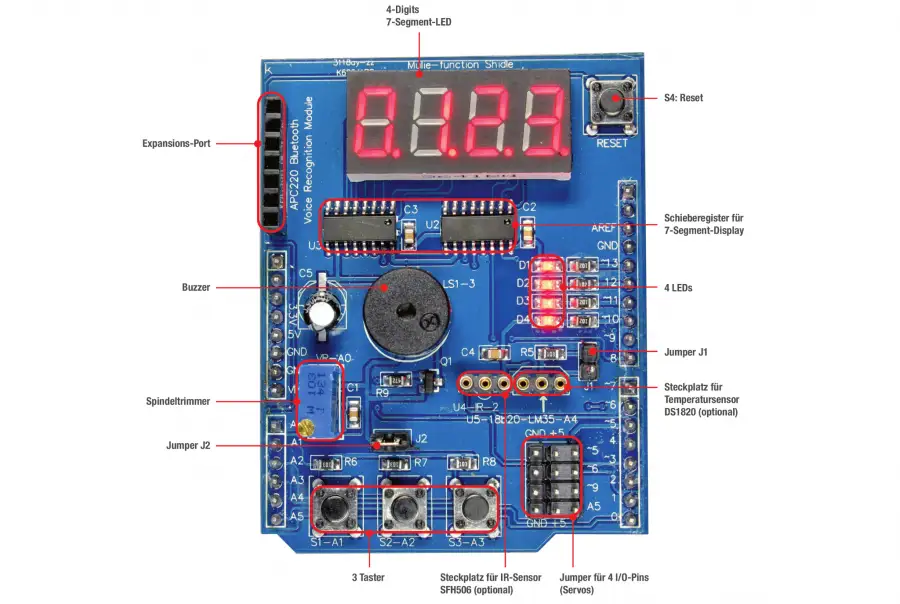

# Multi-purpose Shield V2 Learning Module + Uno R3


This prototype demonstrates the integration of a BDI cognitive agent with an Arduino Uno R3 equipped with a Multi-purpose Shield V2. Using the ARGO architecture, the agent controls LEDs and a buzzer through a predefined sequence of actions while receiving perceptions from the shield's sensors, buttons, infrared receiver, and actuators.

**Execution:** Physical  
**BDI Agent Architecture:** [ARGO](https://jasonembedded.chon.group)  
**Environment:** [Arduino Uno R3](https://www.usinainfo.com.br/placas-arduino-compativel/placa-uno-smd-compativel-arduino-cabo-usb-4485.html) + [Multi-purpose Shield V2](https://www.usinainfo.com.br/shieldsexpansores/shield-multifuncoes-para-arduino-k586-com-buzzer-display-push-button-interfaces-extras-4778.html)  
**Difficulty:** Introductory

## Overview

The Multi-purpose Shield V2 is an educational expansion board designed for Arduino Uno microcontrollers. It integrates multiple input and output components into a single platform, enabling students and developers to explore embedded systems, hardware control, and agent-based applications without additional wiring or soldering.

The shield features a four-digit, seven-segment display controlled by two 74HC595 shift registers, four LEDs, an active buzzer, three push buttons, and a 10 kΩ adjustable potentiometer. It also provides additional interfaces for connecting external components, including DS18B20 or LM35 temperature sensors, infrared receivers, Bluetooth modules, and voice recognition modules.

In this prototype, the shield is integrated with a BDI cognitive agent through the Javino communication protocol. The agent can independently control the four LEDs, update individual display digits, and activate or deactivate the buzzer while receiving button-press events as perceptions.


## Architecture

This prototype follows the folow architecture. 

### L4 — Reasoning Layer
TODO
<!-- The agent establishes a serial connection with the Arduino Uno R3 and executes the `helloWorld` goal once the connection is available. This goal triggers a predefined sequence of actions: turning the red and blue LEDs on and off, activating and deactivating the buzzer, and changing the RGB LED through white, green, blue, and red before turning it off. A one-second interval separates consecutive commands.

The agent also defines plans triggered by belief-addition events (`+b`) associated with perceptions received from the shield, including sensor readings, button states, infrared remote-control commands, and actuator states. These plans print the corresponding belief values to the console.

If the `helloWorld` goal cannot be executed because no applicable plan is available, the agent waits for a randomized interval before retrying.

- **Agent(s):** `bob`
- **Frameworks:** Jason, JaCaMo, JasonEmbedded, and ChonIDE.
- **Source code:**
  - [Jason](reasoning/jason/)
  - [JaCaMo](reasoning/jacamo/)
  - [JasonEmbedded](reasoning/jasonEmbedded/)
  - [ChonIDE](reasoning/chonIDE/multiPurposeShield.chon)


 -->

### L3 — Interfacing Layer

#### Actions

The following examples show agent-side commands (the actual `.act(...)` syntax depends on the agent integration):

```asl
.act(led1On);           // Turn LED 1 on
.act(led1Off);          // Turn LED 1 off
.act(led2On);
.act(led2Off);
.act(led3On);
.act(led3Off);
.act(led4On);
.act(led4Off);

.act(setDisplay1(1));   // Leftmost digit
.act(setDisplay2(2));
.act(setDisplay3(3));
.act(setDisplay4(4));   // Rightmost digit

.act(setHour(18));      // Positions 1 and 2: 18
.act(setMin(33));       // Positions 3 and 4: 33

.act(alarmOn);          // Play buzzer pattern (no LED used)
.act(alarmOff);         // Stop buzzer
```

**Display positions:** `1` is the leftmost digit; `4` is the rightmost. Each `setDisplayN(V)` accepts a single decimal digit (`0`–`9`) and updates only that position. `setHour(H)` accepts `0`–`23`; `setMin(M)` accepts `0`–`59`. The display shows four digits without automatically advancing the time.

**Buzzer:** `alarmOn` starts the beep pattern configured in the firmware; `alarmOff` requests that the buzzer stop. Neither action changes any LED.

#### Percepts

A perception request returns the device identifier and the state of the three buttons:

```asl
+device(multiFunctionShieldV2).
+btn1(pressed | released).
+btn2(pressed | released).
+btn3(pressed | released).
```

Button presses are **latched** until the next perception request. After that request, the recorded press is cleared. The firmware does not currently report display values or LED states as perceptions.


### L2 — Controlling Layer

he Arduino firmware interprets Javino commands, writes to the shield, reads button events and sends perceptions on request. It does **not** run an autonomous clock or check alarm times.

- **Controller:** Arduino Uno R3 (ATmega328P).
- **Firmware:** [arduino.ino](controlling/arduino/arduino.ino).
- **Serial speed:** 9600 baud.
- **Arduino libraries:** [Javino](https://github.com/chon-group/javino2arduino), [MultiFuncShield](https://github.com/hpsaturn/MultiFuncShield-Library), and `Wire`.

The display is initialized to `0000`, all four LEDs are turned off, and the buzzer is stopped at startup.


### L1 — Actuating Layer

The actuating layer consists of a Multi-purpose Shield V1 mounted on an Arduino Uno R3. The shield integrates sensors and actuators into a single board, allowing the cognitive agent to interact with the physical environment without additional wiring.

**Physical implementation:**

- **Controller board:** Arduino Uno R3.
- **Expansion board:** Multi-purpose Shield V2.
- **Assembly:** Attach the shield directly to the Arduino Uno R3.

#### Hardware Pinout




**Additional documentation:**


#### Hardware Requirements

To reproduce this experiment, you need an **Arduino Uno R3** and a **Multi-purpose Shield V1**. The shield connects directly to the Arduino, so no additional wiring or soldering is required.

| Component | Quantity | Where to buy |
|---|---|---|
| Arduino Uno + USB Cable | 1 | [UsinaInfo](https://www.usinainfo.com.br/placas-arduino-compativel/placa-uno-smd-compativel-arduino-cabo-usb-4485.html) |
| Multi-purpose Shield V2 | 1 | [UsinaInfo](https://www.usinainfo.com.br/shieldsexpansores/shield-multifuncoes-para-arduino-k586-com-buzzer-display-push-button-interfaces-extras-4778.html) |


#### Simulated Implementation

- Not available for this prototype.


## Requirements

To reproduce this prototype, the following hardware and software are required:

**Hardware:**
- Arduino Uno R3 (or compatible board).
- Multi-purpose Shield V2.
- USB cable for connecting the Arduino to the computer.

See [Hardware Requirements](#hardware-requirements) for purchasing links and compatibility information.

**Software:**
- Arduino IDE or Arduino CLI.
- Jason, JaCaMo, or JasonEmbedded, depending on the selected reasoning implementation.
- Javino library for Arduino.
- DHT Sensor Library and its required dependencies.
- Arduino-IRremote library.
- A computer with an available USB serial port.

The provided agent configuration uses `/dev/ttyUSB0` on Linux. Adjust the serial port according to your operating system and device configuration.

## How to Run

1. Connect the Multi-purpose Shield V1 to the Arduino Uno R3.
2. Connect the Arduino to your computer using a USB cable.
3. Open [arduino.ino](controlling/arduino/arduino.ino) in the Arduino IDE and install the required libraries.
4. Select the Arduino Uno board and the corresponding serial port, then compile and upload the firmware.
5. Choose one of the available implementations in the [Reasoning Layer](#l4--reasoning-layer).
6. Configure the serial port in the agent's `serialPort` belief. On Linux, the default example is `ttyUSB0`.
7. Start the selected agent project.

**Expected behavior:**

After establishing the serial connection, the agent `bob` executes the `helloWorld` goal. The red and blue LEDs turn on and off, the buzzer is activated and deactivated, and the RGB LED cycles through white, green, blue, and red before turning off.

A one-second interval separates consecutive actions.

The agent also receives perceptions from the shield, including sensor readings, button states, infrared remote-control commands, and actuator states. These perceptions are displayed in the agent's console as belief-addition events occur.

## Authors and References

N. Lazarin, C. Pantoja, and J. Viterbo. " Towards a Toolkit for Teaching AI Supported by Robotic-agents: Proposal and First Impressions", in Proceedings of the 31st Workshop on Computing Education, João Pessoa/PB, 2023, pp. 20-29, doi: https://doi.org/10.5753/wei.2023.229753. 