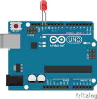
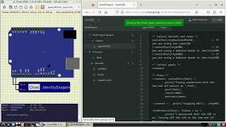

# PrototypeName



> **Summary:** [Briefly describe what the cognitive agent(s) do, which devices or simulated components they interact with, and the goal of the prototype.]

**Execution:** [Physical / Simulated / Both]  
**BDI framework:** [Jason / JaCaMo / JasonEmbedded / Other Jason-based framework]  
**Environment:** [SimulIDE / Webots / Arduino / PIC / Other]  
**Difficulty:** [Introductory / Intermediate / Advanced]

## Overview

[Describe the scenario, the agent's goals, and the observable behavior.]

## Architecture

This prototype follows the five-layer architecture. Include only the layers and technologies actually used in your implementation.

### L5 — Managing Layer

[Describe operating-system services, setup, deployment, network management, or execution scripts, if applicable.]

- **Platform:** [e.g., chonOS, GNU/Linux, or Not applicable]
- **Files:** [Link to configuration or scripts in `managing/`, if any]

### L4 — Reasoning Layer

[Describe the cognitive agents, beliefs, goals, plans, and interactions.]

- **Agent(s):** [Name and role]
- **Framework:** [Jason / JaCaMo / JasonEmbedded / ...]
- **Source code:** [Link to project under `reasoning/`]


### L3 — Interfacing Layer

[Describe the protocol/middleware connecting agents to the device or simulator.]

- **Middleware/protocol:** [e.g., Javino, serial protocol, virtual ports]
- **Connection:** [e.g., `/dev/ttyUSB0` or `/dev/ttyEmulatedPort0`]

**Percepts** received by agents:

```text
perceptName(Value)   // Describe meaning and possible values
```

**Actions** issued by agents:

```text
actionName          // Describe the expected effect
```

### L2 — Controlling Layer

[Describe the low-end IoT controller, firmware, or simulated equivalent.]

- **Controller:** [e.g., Arduino Uno, PIC, simulated controller]
- **Firmware/source:** [Link under `controlling/`]
- **Build/deployment:** [Instructions, or Not applicable]

### L1 — Actuating Layer

[Describe sensors, actuators, circuits, and physical or simulated environments.]

**Physical implementation (optional):**

- **Components:** [List of sensors, actuators, and boards]
- **Schematic:** [Link under `actuating/physical/`]

**Simulated implementation (optional):**

- **Simulator:** [e.g., SimulIDE, Webots]
- **Simulation project:** [Link under `actuating/simulated/`]

> A physical implementation is **not required**. A fully simulated prototype is welcome.

## Requirements

- [Required tools and versions]
- [Required libraries, middleware, and dependencies]
- [Supported operating systems or target devices]

## How to Run

1. [Install the required tools.]
2. [Open or start the physical/simulated environment.]
3. [Configure the connection between agents and the environment.]
4. [Build/upload firmware, if applicable.]
5. [Run the MAS and verify the expected behavior.]

**Expected behavior:** [Describe the observable result and relevant console/percept output.]

## Demonstration

[Add a screenshot, animated image, or a link to a demonstration video.]

[](https://youtu.be/WbX-HOahMkc)

## Authors and References

- **Contributors:** [Names or GitHub handles]
- **References:** [Papers, documentation, or other sources, if applicable]
- **License:** [State applicable license or refer to the repository license]
